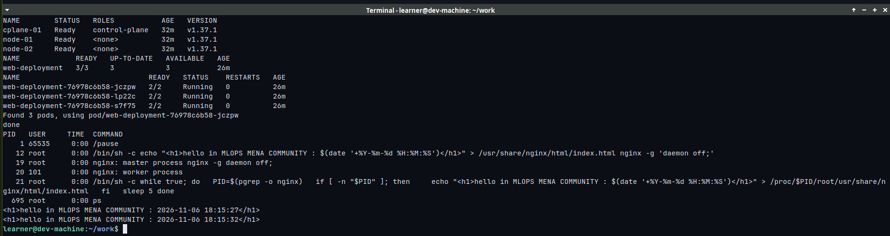
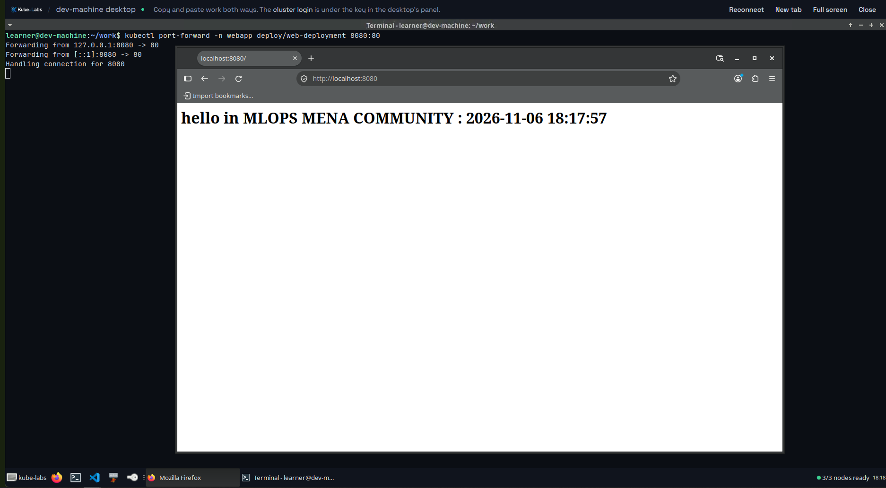
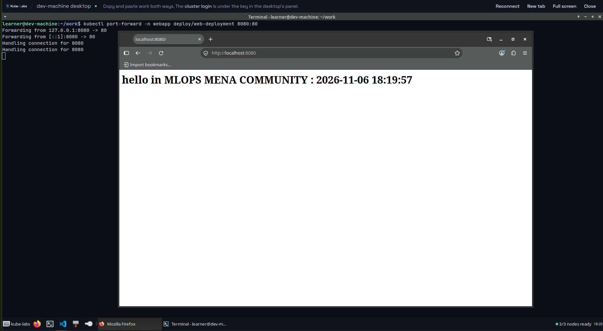
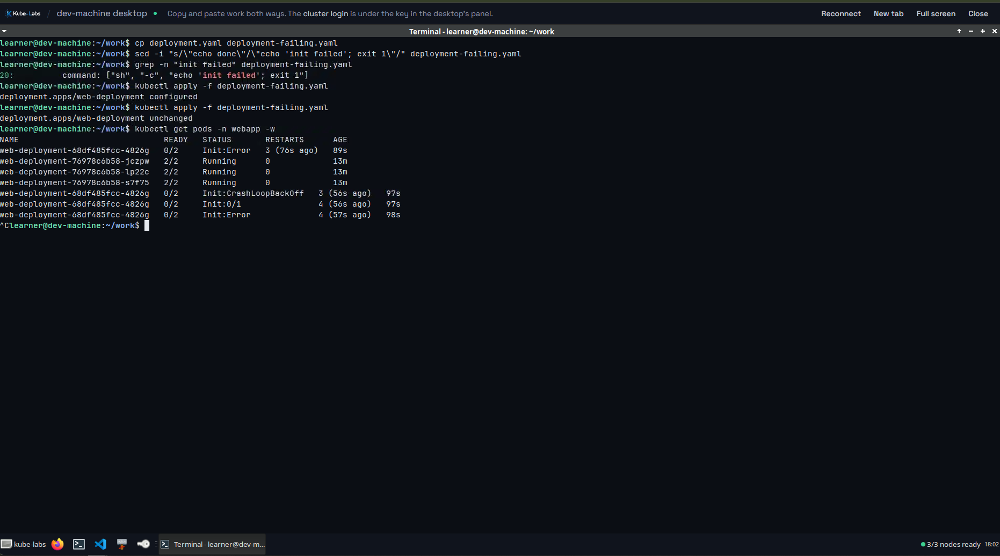
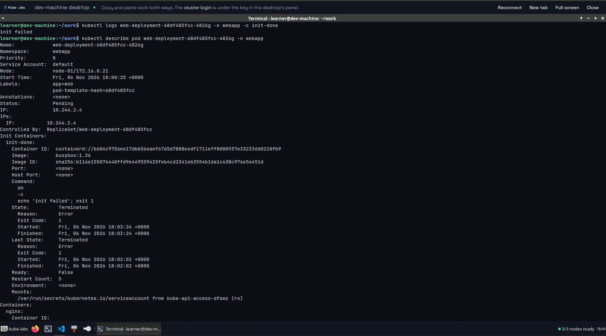
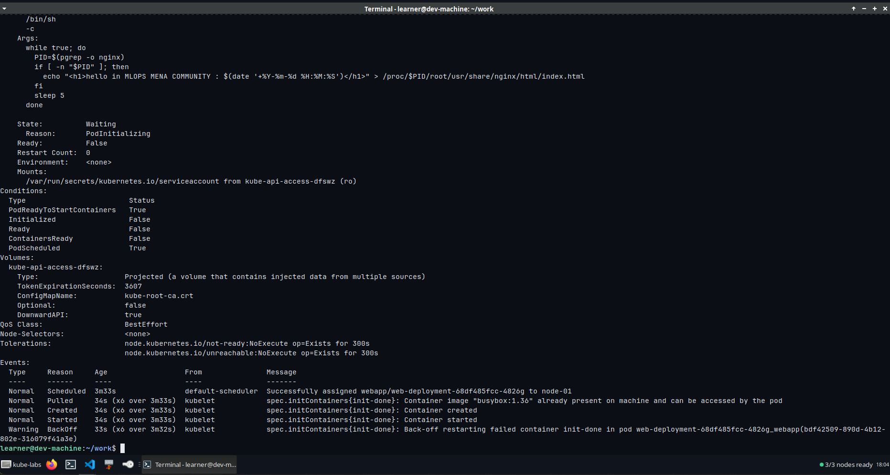
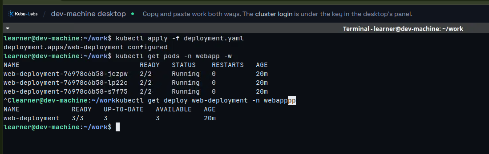

# Task 1: Multi-container Pods (Init Container & Sidecar)

## Overview

This task runs an nginx "hello" page on a 3-node Kubernetes cluster. Each Pod has three containers and **no volume**:

| Container | Type | Job |
|-----------|------|-----|
| `init-done` | Init container | Prints `done` and exits. The other containers start only if it succeeds. |
| `nginx` | Main container | Writes `index.html` with the current time, then serves it on port 80 |
| `time-updater` | Sidecar | Rewrites `index.html` with the new time every 5 seconds |

The Pod uses `shareProcessNamespace: true`, so the sidecar can see the nginx process and write into its filesystem through `/proc/<nginx-pid>/root`. This is why no shared volume is needed.

## Environment

- Platform: **kube-labs.com** (kubeadm cluster, Kubernetes v1.37.1)
- Cluster: 1 control-plane (`cplane-01`) + 2 workers (`node-01`, `node-02`)
- Note: my local machine has only 8 GB RAM, so I used kube-labs instead of minikube.

## Files

| File | Description |
|------|-------------|
| `deployment.yaml` | The working Deployment |
| `deployment-failing.yaml` | Same Deployment, with the init command changed to `exit 1` |

## Steps

### 1. Check the cluster

```bash
kubectl get nodes
```

All 3 nodes are `Ready`.



### 2. Create the namespace

```bash
kubectl create namespace webapp
```

### 3. Deploy

```bash
kubectl apply -f deployment.yaml
kubectl get pods -n webapp -w
```

The 3 Pods reach `2/2 Running` (the init container has finished, so only `nginx` and `time-updater` count).

### 4. Check the page

```bash
kubectl port-forward -n webapp deploy/web-deployment 8080:80
```

Opening `http://localhost:8080` shows the page. After refreshing, the time changes.

| First load | After refresh |
|------------|---------------|
|  |  |

### 5. Verification

| # | Check | Result |
|---|-------|--------|
| 1 | 3 nodes | `cplane-01`, `node-01`, `node-02` are `Ready` |
| 2 | Deployment ready | READY `3/3` |
| 3 | Pods running | 3 Pods, each `2/2 Running` |
| 4 | Containers | `init-done nginx time-updater` |
| 5 | Init succeeded | `kubectl logs ... -c init-done` prints `done` |
| 6 | Sidecar sees nginx | `ps` in `time-updater` lists `nginx: master process` |
| 7 | Time updates | Two reads 5 seconds apart show different times |
| 8 | No volumes | `jsonpath='{.spec.template.spec.volumes}'` prints nothing |


### 6. Make the init container fail

I changed only the init container command:

```yaml
command: ["sh", "-c", "echo 'init failed'; exit 1"]
```

Then applied it again (without deleting the Deployment):

```bash
kubectl apply -f deployment-failing.yaml
kubectl get pods -n webapp -w
kubectl logs <new-pod> -n webapp -c init-done
kubectl describe pod <new-pod> -n webapp
```







### Answers

**Which status does the new Pod show?**
`Init:Error`, then `Init:CrashLoopBackOff`, with READY `0/2`. The init container exits with code 1 (`Exit Code: 1` in `describe`), and Kubernetes keeps restarting it with increasing delays.

**Do `nginx` and `time-updater` start?**
No. They stay in `Waiting` with reason `PodInitializing`, because init containers must complete successfully before the main containers start.

**Is the page still reachable, and why?**
Yes. The Deployment uses a rolling update, so it does not remove the old Pods until the new Pod is Ready. The 3 old Pods stay `2/2 Running` and keep serving the page.

### 7. Fix it

```bash
kubectl apply -f deployment.yaml
kubectl get deploy web-deployment -n webapp
```

The Deployment goes back to the working version. The failing Pod is removed, and the result is READY `3/3`, UP-TO-DATE `3`.



## What I learned

- Init containers must succeed before any main container starts.
- A failing init container blocks only the new Pod. A rolling update keeps the old Pods serving.
- `shareProcessNamespace: true` plus `SYS_PTRACE` lets a sidecar reach another container's filesystem through `/proc/<pid>/root`, without a shared volume.
